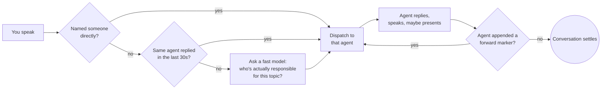
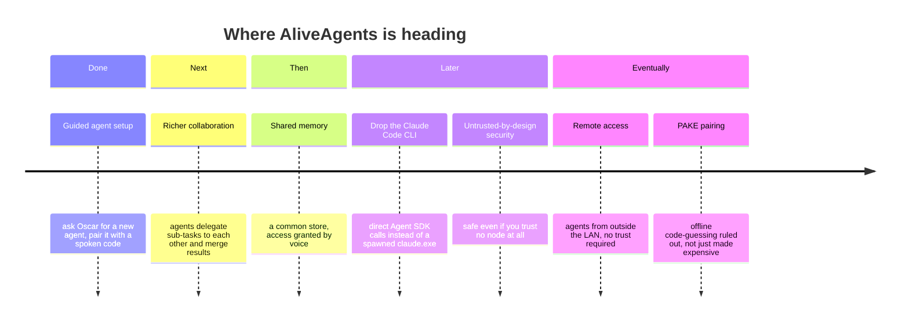

# AliveAgents

**A local network of AI agents with real voices and real faces, living on your own machines.**

[](./LICENSE)
[](https://claude.com/claude-code)

AliveAgents turns [Claude Code](https://claude.com/claude-code) into a small team of persistent, embodied assistants — Oscar and Nova by default — that you talk to out loud. Each agent runs on its own machine, has its own voice (via local text-to-speech), and animates its own face on screen. They hand conversations off to each other automatically when it makes sense, and they can put things up on a shared display — a dashboard, search results, a slide — while they talk you through it.

Nothing leaves your own network. There is no cloud service in the middle: agents talk to each other over a directly encrypted connection between the machines you own.

> **Run this on a network you trust.**
>
> This is a hobby project, and it has not had a proper security review — only the ad-hoc hardening described below. Use it on your own home network, between machines you own. Don't run it on shared WiFi, in an office, or anywhere you would not also leave a laptop unlocked.
>
> Agent-to-agent traffic is genuinely protected: mutual TLS 1.3 with pinned certificates, no shared CA. What is **not** protected to the same standard is each machine's local web server, which the browser overlay needs and which therefore speaks plain HTTP on the LAN. Commands, the chat transcript and file uploads are restricted to the machine you are sitting at; presentations are reachable only through an unguessable URL; but the face itself, the deck runtime and those URLs travel unencrypted, and anyone on the same network can watch the face.
>
> A thorough review — and a proper answer for running this across networks you don't control — is on the roadmap and not done yet.

<p align="center"></p>

<p align="center"><sub><b>Oscar</b> is the hub — the one whose microphone you talk to. Everything else is a <b>node</b>: as many laptops and phones as you want, each running its own agent with its own voice and face, all pulled into the conversation as needed. The shared display in the middle is up for grabs — whichever agent has something to show puts it there while it talks.</sub></p>

---

## What it actually does

- **You talk, they talk back.** Press-to-toggle microphone input, real speech recognition, real synthesized voices per agent — no typing required.
- **Every agent has a face.** A small animated avatar (idle / thinking / speaking) rendered in the browser, so you always have a visual sense of who's doing what.
- **Agents hand off to each other.** Ask a general question and the right agent picks it up automatically, based on what each one is actually responsible for — not keyword matching, genuine language understanding. Say a name directly to address someone specifically. Say "everyone" to broadcast to the whole network.
- **A shared display.** Any agent can show you something instead of just describing it — a chart, a table, a webpage it built on the spot — while it keeps talking. The display waits its turn instead of agents talking over each other.
- **Hand an agent your files.** Open the drop page on the hub machine and drag photos or documents onto whichever agent should have them. They land in that agent's own `inbox/` folder, on the machine it actually runs on, and its next reply takes them into account — describe this picture, summarise that PDF, file it away. Transfers are chunked over the same encrypted link, so size is not a problem.
- **Agents present, not just display.** When an answer genuinely has several parts, an agent can build a slide deck on the spot and talk you through it, advancing its own slides in time with what it's saying. You can click or arrow-key back through it yourself afterwards. Each agent decides for itself whether a question is worth a deck at all — a short answer stays a short answer.
- **It's just Claude Code underneath.** Every agent's "brain" is a real, independent Claude Code CLI session — including tool use, file access scoped per agent, and its own persistent memory across conversations.
- **Encrypted between machines.** Every machine has its own self-signed certificate; every agent-to-agent connection is mutual TLS 1.3. There's no shared certificate authority, so nothing outside your own set of devices can join that link or eavesdrop on it. The browser-facing side is a different story — see the note below.

## How it's built

One machine is the **hub** — it listens to your microphone and decides who should answer. Every other machine is a **node**, connected to the hub over a direct, mutual-TLS 1.3 link with no shared certificate authority: each side pins the other's exact certificate, so nothing outside your own devices can ever join in or listen. Every machine, hub or node, runs the same two small pieces locally: a bridge to its own Claude Code CLI session, and a speech/face layer that turns the reply into a voice and an animation.

### How a conversation actually gets routed



Agents decide for themselves, every single turn, whether someone else on the network should react next — by quietly appending a machine-only marker to the end of their reply, which is stripped out before anything is spoken or shown. There's no fixed script and no forced back-and-forth: if nothing needs adding, the conversation just ends naturally.

## Setup

You'll need two things installed system-wide first: **[Node.js](https://nodejs.org/)** and the **[Claude Code CLI](https://claude.com/claude-code)**, logged in with `claude setup-token`. Then, per machine:

```bash
git clone git@github.com:AliveAgents/AliveAgents.git
cd AliveAgents
npm install
```

1. **Generate the hub's identity.** `sh make-certs.sh` on the hub machine. Additional machines don't need this — see below.
2. **Configure the hub.** Copy `net-config.example.json` to `net-config.json` and set `role: "hub"` and `self`. The list of machines, and each agent's name and what it is responsible for, fill themselves in as agents join. Only the hub changes them later: `/agent name <machine> <Name>` or `/agent domain <machine> <text>` on its console or its chat page (there, Windows Hello asks first and names the change), and `/network` shows who is who. An agent can also ask for a change to its own entry: the request pops up on the hub's face page with Accept and Decline, and nothing changes until you click one and confirm the Windows Hello dialog that says what you accept.
3. **Add a voice.** Drop a [Piper](https://github.com/OHF-Voice/piper1-gpl) voice model into `tools/piper/voices/` per agent — any language, any voice.
4. **Your own secrets stay local.** Copy `token.local.bat.example` → `token.local.bat` with your own Claude Code token. Never commit the real file — `.gitignore` already excludes anything matching `*.local.*`.
5. **Start it.** `start.bat` on the hub, `start-node.bat` on every Windows node, `bash start-node.sh` on a Linux node or a phone.
6. **Open the face.** Open `http://localhost:8787/` in any browser on that machine — every machine serves its own face page, no browser extension needed.
7. **Decide what the agent may do.** The shield button on the face page lists that machine's agent's permissions: web search, the browser, presentations, receiving files, involving other agents, the command line, and so on. Every change is confirmed in a dialog of the operating system that names exactly what changes -- Windows Hello on a PC, the fingerprint prompt on a phone (needs the Termux:API app, as the voice does). No agent and no other machine can change them, and an agent that controls the browser cannot reword what you confirm.
8. **Updates come by themselves.** Each agent checks this repository at start and once a day. When a newer signed version exists, its face page says so; Install asks for Windows Hello or the fingerprint, naming the version, and the agent restarts once it is idle. Only versions signed with the release key on the maintainer's PC are installed -- see `publish-release.js`. Settings, keys and conversations are never touched.

Talk to the hub's microphone button and the network takes it from there.

### Adding another agent

Say *"set up a new agent called Ada for the calendar"*. The hub reads you a one-time pairing code, and on the new machine you run:

```bash
enroll.bat 192.168.178.90 K7QF-2M9X-BTLR ada
```

That machine generates its own key pair locally and joins — **no private key is ever copied between machines**, and the hub picks it up without a restart. The code exists to prove the exchange is happening with the machine you're standing at rather than someone else on the network: it's mixed into a proof covering both certificates, so a relayed handshake doesn't verify. (`/provision <name>` on the hub console does the same thing without the microphone.)

**A phone as a node.** An Android phone runs an agent through [Termux](https://termux.dev/), without root. Clone the repository on the phone and run `bash setup-termux.sh` once — it installs what is needed and checks that Claude Code starts and receives its prompts intact — then enroll with `node enroll.js <hub-ip> <code> <name>` and start with `bash start-node.sh`. A phone speaks with its own text-to-speech engine, so it needs no voice model.

## Roadmap

AliveAgents works today as a real-time, multi-agent voice network. Here's the direction it's heading:



**Next**
- **Deeper agent-to-agent collaboration** — richer handoffs, agents that can delegate sub-tasks to each other and merge the results, not just forward a single conversation turn.
- **The main agent as network manager.** Onboarding a new agent by voice already works (see [Adding another agent](#adding-another-agent)) — Oscar asks what it should be called and be responsible for, and hands you a pairing code. What's still ahead is the rest of the handover: briefing it on its role, and granting it access to shared memory, the main display, and the files it needs, the way a DHCP server hands a new device its whole configuration the moment it joins.

**Then**
- **A shared, permissioned memory.** A central store agents can read from — but only the specific data you've explicitly granted them access to by voice, nothing broader by default. Drop a file in by drag-and-drop as a human, and it's securely managed from there without any manual wiring.

**Later**
- **Independent of the Claude Code CLI.** Every agent's brain is currently a spawned `claude.exe` process, kept alive across turns via Claude Code's own `--resume <sessionId>`. Moving to the Claude Agent SDK directly would drop that whole subprocess-and-session-file layer — including the Windows `cmd.exe` quoting workaround it requires today — for a first-class integration instead of a CLI wrapped in a CLI.
- **Untrusted-by-design network security.** Real isolation per agent, so a compromised or misbehaving node can't reach another's data, tools, or display — the network stays safe without anyone on it actually needing to be trusted. Includes an out-of-band action authenticator for the main agent's own more consequential steps, closer to an authenticator app than a blanket permission grant — one layer of a network built to assume nobody's trustworthy by default.

**Eventually**
- **Remote access, including nodes you don't control.** Once that untrusted-by-design security lands, connecting over a VPN means more than just reaching outside the LAN — the network can safely work with outside agents you never vetted yourself, no special trust extended first.
- **Password-authenticated pairing (SPAKE2).** Copying certificates by hand is already gone; what remains is that the pairing code is a low-entropy secret. Anyone who records an enrollment can grind it offline — today that costs about 8,500 years even with ten thousand cores, but the resistance comes from the code's length rather than from the protocol. A PAKE removes offline guessing entirely, so security rests on the attempt counter instead. Worth doing once pairing happens over links you don't control; on a home LAN it is not yet the weak point.

## For AI coding agents

If you're an AI agent working in this repository, read [`CLAUDE.md`](./CLAUDE.md) first — it has the setup steps, file map, and conventions this project expects.

## License

[MIT](./LICENSE) — free to use, modify, and share, commercial or not.
