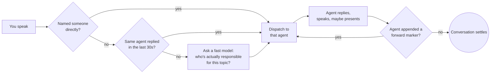
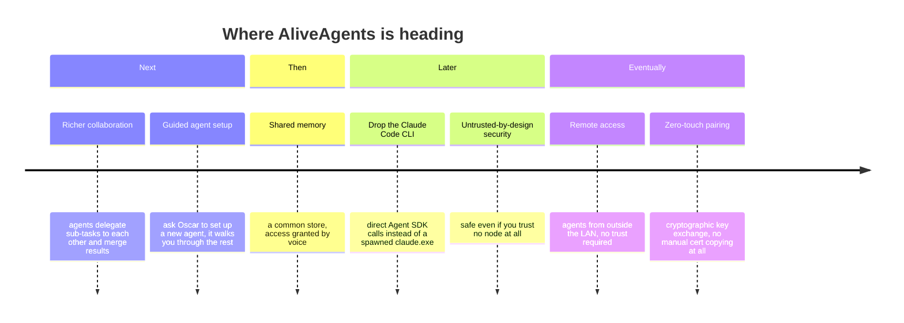

# AliveAgents

**A local network of AI agents with real voices and real faces, living on your own machines.**

[](./LICENSE)
[](https://claude.com/claude-code)

AliveAgents turns [Claude Code](https://claude.com/claude-code) into a small team of persistent, embodied assistants — Oscar and Nova by default — that you talk to out loud. Each agent runs on its own machine, has its own voice (via local text-to-speech), and animates its own face on screen. They hand conversations off to each other automatically when it makes sense, and they can put things up on a shared display — a dashboard, search results, a slide — while they talk you through it.

Nothing leaves your own network. There is no cloud service in the middle: agents talk to each other over a directly encrypted connection between the machines you own.

<p align="center"></p>

<p align="center"><sub><b>Oscar</b> is the hub — the one whose microphone you talk to. Everything else is a <b>node</b>: as many laptops and phones as you want, each running its own agent with its own voice and face, all pulled into the conversation as needed. The shared display in the middle is up for grabs — whichever agent has something to show puts it there while it talks.</sub></p>

---

## What it actually does

- **You talk, they talk back.** Press-to-toggle microphone input, real speech recognition, real synthesized voices per agent — no typing required.
- **Every agent has a face.** A small animated avatar (idle / thinking / speaking) rendered in the browser, so you always have a visual sense of who's doing what.
- **Agents hand off to each other.** Ask a general question and the right agent picks it up automatically, based on what each one is actually responsible for — not keyword matching, genuine language understanding. Say a name directly to address someone specifically. Say "everyone" to broadcast to the whole network.
- **A shared display.** Any agent can show you something instead of just describing it — a chart, a table, a webpage it built on the spot — while it keeps talking. The display waits its turn instead of agents talking over each other.
- **It's just Claude Code underneath.** Every agent's "brain" is a real, independent Claude Code CLI session — including tool use, file access scoped per agent, and its own persistent memory across conversations.
- **Private by construction.** Every machine on the network has its own self-signed certificate; every connection is mutual TLS 1.3. There's no shared certificate authority, so nothing outside your own set of devices can ever join or eavesdrop.

## How it's built

One machine is the **hub** — it listens to your microphone and decides who should answer. Every other machine is a **node**, connected to the hub over a direct, mutual-TLS 1.3 link with no shared certificate authority: each side pins the other's exact certificate, so nothing outside your own devices can ever join in or listen. Every machine, hub or node, runs the same two small pieces locally: a bridge to its own Claude Code CLI session, and a speech/face layer that turns the reply into a voice and an animation.

### How a conversation actually gets routed



Agents decide for themselves, every single turn, whether someone else on the network should react next — by quietly appending a machine-only marker to the end of their reply, which is stripped out before anything is spoken or shown. There's no fixed script and no forced back-and-forth: if nothing needs adding, the conversation just ends naturally.

## Setup

You'll need two things installed system-wide first: **[Node.js](https://nodejs.org/)** and the **[Claude Code CLI](https://claude.com/claude-code)**, logged in with `claude setup-token`. Then, per machine:

```bash
git clone git@github.com:AliveAgents/AliveAgents.git
cd AliveAgents
npm install
```

1. **Generate your own certificates.** `sh make-certs.sh` on the hub machine creates its identity; run `sh make-certs.sh <name>` for every additional node. Copy each node's `<name>-cert.pem` and the hub's `-cert.pem` to the other machine — never the `-key.pem` files, those stay put.
2. **Configure.** Copy `net-config.example.json` to `net-config.json` on each node and fill in the hub's LAN IP, the agent's name, and its voice. The hub's own `net-config.json` just needs `role: "hub"` and the list of node names it should accept.
3. **Add a voice.** Drop a [Piper](https://github.com/OHF-Voice/piper1-gpl) voice model into `tools/piper/voices/` per agent — any language, any voice.
4. **Your own secrets stay local.** Copy `token.local.bat.example` → `token.local.bat` with your own Claude Code token. Never commit the real file — `.gitignore` already excludes anything matching `*.local.*`.
5. **Start it.** `start.bat` on the hub, `start-node.bat` on every node. Open the printed `localhost` URL in a browser with a userscript manager (e.g. Tampermonkey) installed, and paste in `agent-face-overlay.user.js`.

Talk to the hub's microphone button and the network takes it from there.

## Roadmap

AliveAgents works today as a real-time, multi-agent voice network. Here's the direction it's heading:



**Next**
- **Deeper agent-to-agent collaboration** — richer handoffs, agents that can delegate sub-tasks to each other and merge the results, not just forward a single conversation turn.
- **The main agent as network manager.** Fully onboarding a brand-new agent — provisioning it, briefing it on its role, handing it access to shared memory, the main display, and the files it needs — automatically, the way a DHCP server hands a new device its network configuration the moment it joins. Even a plain setup script walking through cert generation and config would remove most of today's friction; further out, that's a voice request — "hey Oscar, set up a new agent" — and it walks you through the rest, needing only the new machine's IP address and certificate from you by hand.

**Then**
- **A shared, permissioned memory.** A central store agents can read from — but only the specific data you've explicitly granted them access to by voice, nothing broader by default. Drop a file in by drag-and-drop as a human, and it's securely managed from there without any manual wiring.

**Later**
- **Independent of the Claude Code CLI.** Every agent's brain is currently a spawned `claude.exe` process, kept alive across turns via Claude Code's own `--resume <sessionId>`. Moving to the Claude Agent SDK directly would drop that whole subprocess-and-session-file layer — including the Windows `cmd.exe` quoting workaround it requires today — for a first-class integration instead of a CLI wrapped in a CLI.
- **Untrusted-by-design network security.** Real isolation per agent, so a compromised or misbehaving node can't reach another's data, tools, or display — the network stays safe without anyone on it actually needing to be trusted. Includes an out-of-band action authenticator for the main agent's own more consequential steps, closer to an authenticator app than a blanket permission grant — one layer of a network built to assume nobody's trustworthy by default.

**Eventually**
- **Remote access, including nodes you don't control.** Once that untrusted-by-design security lands, connecting over a VPN means more than just reaching outside the LAN — the network can safely work with outside agents you never vetted yourself, no special trust extended first.
- **Zero-touch peer pairing.** The hub sets up a secure connection to a brand-new agent entirely on its own, no manually copying certificate files between machines. That needs real distributed-systems cryptography — secure key exchange and shared randomness between two sides that don't trust each other yet — not just a nicer script.

## For AI coding agents

If you're an AI agent working in this repository, read [`CLAUDE.md`](./CLAUDE.md) first — it has the setup steps, file map, and conventions this project expects.

## License

[MIT](./LICENSE) — free to use, modify, and share, commercial or not.
